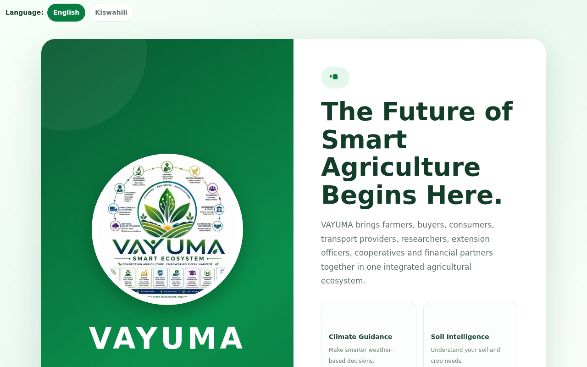
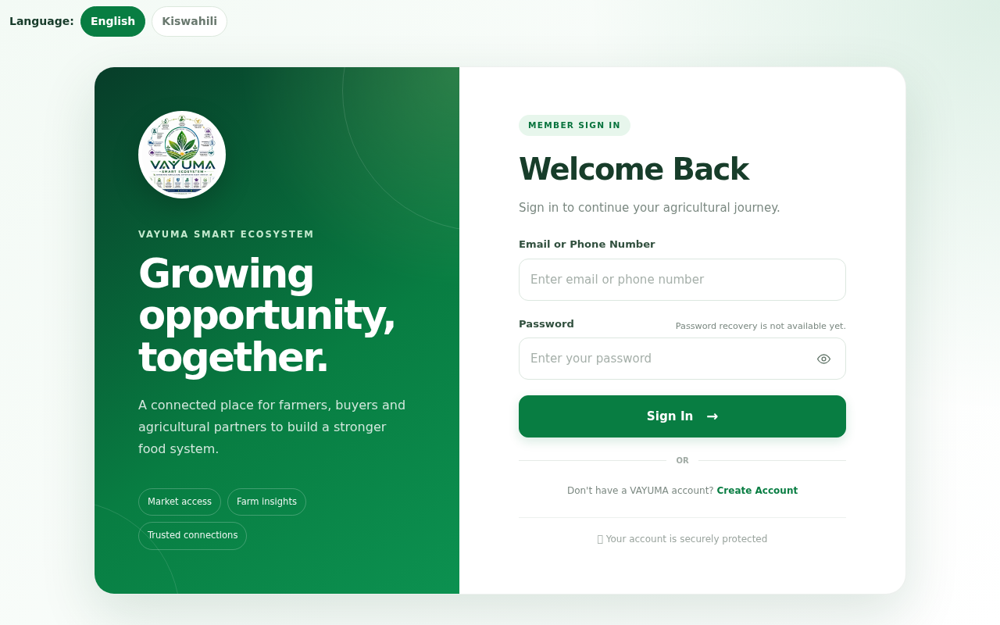

  

<h1 align="center">VAYUMA</h1>

<strong>Connecting agriculture. Empowering every harvest.</strong>

A PHP-powered agricultural ecosystem connecting farmers, buyers and the people who support them.

## About VAYUMA

VAYUMA brings together agricultural stakeholders in one place: farmers, consumers, buyers, cooperatives, transport providers, extension officers, researchers and institutional partners. The platform combines role-based dashboards with marketplace, advisory and subscription experiences.

- **Agricultural marketplace** — explore produce listings, orders and delivery workflows.
- **19 stakeholder roles** — dedicated navigation and profiles for different participants.
- **Farm tools** — climate, soil, crop planning, disease and advisory pages.
- **Subscription management** — role-based plans and administrator-managed pricing.
- **English and Kiswahili** — language choices across the user experience.
- **Installable web app** — PWA manifest, install guidance and an offline fallback, while retaining the PHP backend.

*Screenshots show the local public preview. They do not demonstrate a live database or authenticated account.*

## PWA experience

On a supported browser over HTTPS, open VAYUMA and use the browser's install option or the in-app install prompt. On iPhone and iPad, use Safari's **Share → Add to Home Screen**. An initial online visit is required. Offline mode displays a fallback and reuses selected public static assets; account pages, API responses, uploads, payments and POST requests are not stored for offline use.

Automated Chromium tests cover manifest/installability, worker caching, offline fallback and simulated mobile install prompts. Physical Android/iOS installation, authenticated navigation and deployed HTTPS behavior still need verification. Several dashboards have known horizontal overflow on narrow screens.

## Repository guide

| Path | Purpose |
| --- | --- |
| [`VAYUMA_8/vayuma/`](VAYUMA_8/vayuma/) | PHP application, assets and database migrations |
| [`VAYUMA_8/tests/`](VAYUMA_8/tests/) | PWA, navigation, security and schema checks |
| [`VAYUMA_8/staging/sql/`](VAYUMA_8/staging/sql/) | Reference schema, audit queries and manual migration candidates |
| [`render.yaml`](render.yaml) | Render staging Blueprint |
| [`VAYUMA_8/README.md`](VAYUMA_8/README.md) | Local setup, deployment notes and integration guides |

## Current deployment status

This repository is **not yet verified for production**. Test in an isolated staging environment first. Real Render–TiDB TLS, account and role flows, schema compatibility, backups, durable uploads and sessions require verification. Sub-counties and wards require verified data. The TiDB identity migration candidate requires an end-to-end integration test.

**Payment initiation and settlement are hard locked.** Do not point live callbacks to this application or use production payment credentials. Sandbox reconciliation, transaction safety and independent review are required before payment functionality can be enabled. Legacy payment setup guides describe historical integrations, not a current activation procedure.

## Technology

PHP · MySQL-compatible databases, including TiDB under evaluation · Apache · HTML, CSS and JavaScript · Progressive Web App

See the [application README](VAYUMA_8/README.md) for setup details. Keep credentials, local configuration, uploads and backups out of the repository. No license is currently specified.
